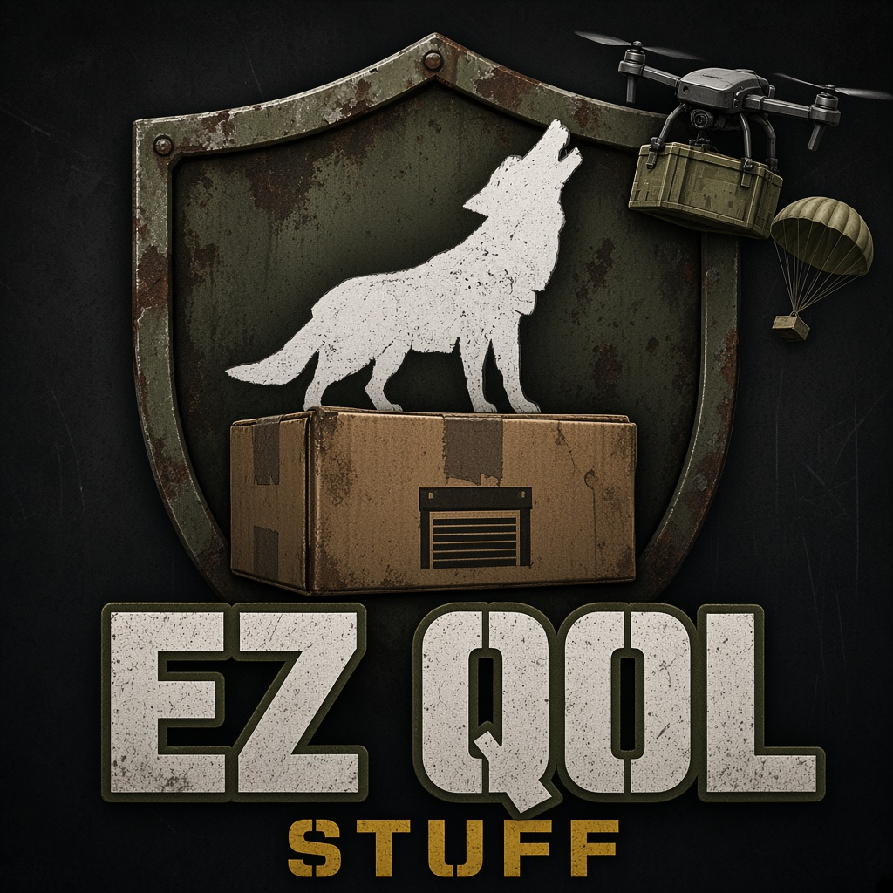

  

# EZ_QOL_Stuff

**Quality-of-life additions for DayZ community servers: drone deliveries, an attack drone, a portable garage kit, a respawn sleeping bag, pineapple farming, vehicle flip and earplugs.**
Version **1.0 beta** · by **Echelon Publishers Group**

  

Steam Workshop: https://steamcommunity.com/sharedfiles/filedetails/?id=3830414136
Running live on the **EchelonZ** community server (https://echelonz.org).

---

## Features
1. **Drone delivery service.** Order from the in-game tablet (centred tablet UI since V0.9.1) in four categories, each with its own icon:
   - **Surgery & medical** (Terje Medicine items)
   - **Ammo drops**
   - **Surprise delivery**
   - **Food & water**

   A drone flies the crate in and drops it. **The crate despawns once it's emptied.**
2. **Attack drone: Strike Package (V0.10).** Buy a lock-on strike from the tablet, lock a player, vehicle, base or ground target, and a drone dives on it. Targets get a warning; wind and sandstorms can cancel it; aborted strikes refund part of the price. Price, cooldowns, range and target types are set in `$profile:EZ_QOL/`, see `EZ_QOL_Stuff/AttackDrone.sample.json`.
   - **PvE/safe-zone protection:** strikes are blocked in **Ninjin PvP/PvE** PvE (2) and safe (5) zones (read from Ninjin's `Zones.json`, no hard dependency), in Expansion safezones and within a configurable buffer.
3. **Portable garage kit.** Built on DayZ Expansion's storage API:
   - **Pack a vehicle with its cargo inside**, carry the kit, and **replant it somewhere else**.
   - **Lock it with a code lock.**
   - **It can be stolen while packed.** Guard your kit.
4. **Sleeping bag (V1.0 beta).** Place it to set your respawn point (one per survivor). Pack, claim and sewing-kit repair actions; respawn cooldown, damage per respawn, decay, zone and enemy-proximity checks, all configurable in `$profile:EZ_QOL/SleepingBagConfig.json` (see `SleepingBagConfig.sample.json`). Uses vanilla placeholder models for now.
5. **Pineapple farming (V1.0 beta, moved from EZLoderScreen).** Seeds, plant, fruit and slices; classnames unchanged, so existing types.xml entries and stored items keep working.
6. **Vehicle flip (V1.0 beta).** Hold F on an overturned, empty, engine-off vehicle, or press **F6** (optional confirm press).
7. **Earplugs and client settings (V1.0 beta).** Earplugs on **End** with volume levels and a HUD indicator; settings menu on **Home** (also an "EZ QOL settings" button in the Esc menu). Keybind group "EZ_QOL". Saved client-side to `$profile:EZ_QOL_client.json`.
8. **Coexists with Virtual Garage System (VGS).** It uses its own RPC names (`EZ_QOL_Garage_*`) and its own storage folder (`$profile:EZ_QOL/Garage`), and never reads VGS data.

## Requirements and dependencies
From `config.cpp` `requiredAddons[]`:
| Addon | Provided by |
|---|---|
| `DZ_Data`, `DZ_Scripts`, `DZ_Gear_Camping`, `DZ_Gear_Food`, `DZ_Gear_Cultivation`, `DZ_Gear_Tools`, `DZ_Weapons_Explosives` | The base game (food/cultivation for pineapples, tools for the sewing-kit repair, explosives for the drone marker smoke and the attack drone) |
| `JM_CF_Scripts` | **Community Framework (CF)** |
| `DayZExpansion_Core_Scripts` | **DayZ Expansion** Core |
| `DayZExpansion_Vehicles_Scripts` | **DayZ Expansion** Vehicles |
| `DayZExpansion_BaseBuilding_Scripts` | **DayZ Expansion** BaseBuilding (code lock) |
| `DayZExpansion_Market_Scripts` | **DayZ Expansion** Market (drone payments) |

Medical deliveries use **Terje Medicine** item classes (e.g. `TerjeSurgicalKit`). Install TerjeMedicine, or edit the medical category in the config.

Ninjin PvP/PvE zone support is optional: if Ninjin's `Zones.json` exists, the attack drone respects it.

## Install (server owners)
1. Subscribe to the Workshop item, or copy `@EZ_QOL_Stuff` into the server folder.
2. Load order: `-mod=@CF;@DayZ-Expansion-Core;@DayZ-Expansion-Vehicles;@DayZ-Expansion-BaseBuilding;@DayZ-Expansion-Market;[@TerjeMedicine;]@EZ_QOL_Stuff` (match your mod folder names).
3. Copy the mod's `keys/*.bikey` (shipped with the Workshop download) into your server's `keys/` folder.
4. Merge `EZ_QOL_Stuff/types_drone_snippet.xml` and `EZ_QOL_Stuff/types_sleepingbag_snippet.xml` into your mission's `db/types.xml` (keep your existing pineapple entries).
5. Start the server once. Then edit the generated config under `$profile:EZ_QOL/`, using `EZ_QOL_Stuff/DroneDelivery.sample.json`, `AttackDrone.sample.json` and `SleepingBagConfig.sample.json` as references (zones, prices, categories, altitude).
6. Restart and test: open the tablet, order a drone, deploy a garage kit.

## Building from source
- Pack `EZ_QOL_Stuff/` with Addon Builder or pboProject and **sign it with your own key**. Keys and signed or packed files are never committed.
- The models are MLOD (unbinarized); see `docs/MODEL_NOTES.md`.

## Compatibility
- Works alongside **Virtual Garage System**. There's no shared data, and the hologram and placement hooks apply only to `EZ_QOL_GarageKit`.
- Requires the Expansion modules listed above. Other garage or storage mods that override the same vanilla actions are untested.
- Built for DayZ private community servers (modded).

## Optional add-on (separate, NOT part of the mod)
`optional/EZ_QOL_ExpansionCompat/` is a **separate, optional add-on**. It is **not** part of EZ_QOL_Stuff, isn't built into its PBO, and EZ_QOL_Stuff doesn't need it: the mod is standalone. Server owners who also run Expansion Spawn Selection can build it themselves to show the sleeping bag in Expansion's spawn menu. It's untested in game; see its `README.txt`.

## Credits
- **Echelon Publishers Group** team; created by **Robert J. Morris (LordSausageFinger)**.
- **"Delivery drone Gameready (Free)"** by **Egor Likhachev**, CC BY 4.0, https://sketchfab.com/3d-models/delivery-drone-gameready-free-c22b1060860e47b4adbc1e9007b70b18 (modified: converted for DayZ, split meshes, retextured)
- **"Military Rugged PDA / Tactical Tablet"** by **Snupp**, CC BY 4.0, https://sketchfab.com/3d-models/military-rugged-pda-tactical-tablet-24b5e19dcb9e4970b5c211787c7f3fd0 (modified as above)
- **"Cloth Hangar"** by **CommonSpence**, CC BY 4.0, https://sketchfab.com/3d-models/cloth-hangar-dd53c69aa57b4c048d32363149b9966c (the base of the garage model; rescaled, LODs, collision and memory points added)
- Sleeping bag: planned model "SLEEP BAG" by **Igor Rodrigues**, CC BY 4.0, https://sketchfab.com/3d-models/sleep-bag-ccd1976fba4445cdb4d6769dbf4db653 (V1.0 beta ships vanilla placeholders)
- Full notices are in `EZ_QOL_Stuff/CREDITS.txt`. CC BY 4.0: https://creativecommons.org/licenses/by/4.0/
- Built for DayZ. DayZ is a trademark of Bohemia Interactive a.s.; this project isn't affiliated with or endorsed by Bohemia Interactive. Mod content follows Bohemia's DayZ modding licence terms.

## License

Original work is licensed under [CC BY-NC-SA 4.0](https://creativecommons.org/licenses/by-nc-sa/4.0/): share and adapt it with credit to Echelon Publishers Group, non-commercially, under the same license. The credited 3D models stay under CC BY 4.0. See [LICENSE](LICENSE).
